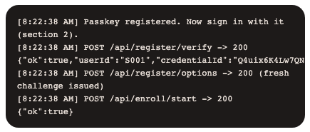
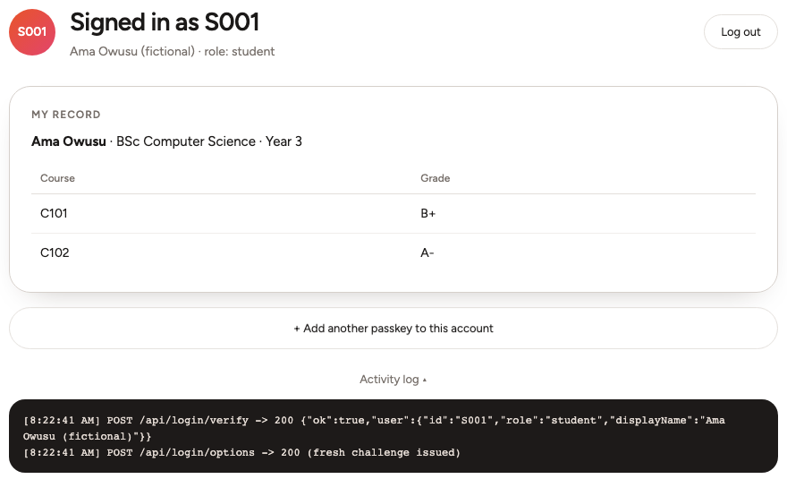
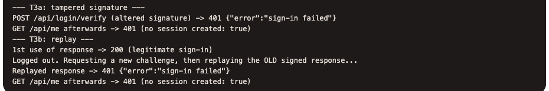
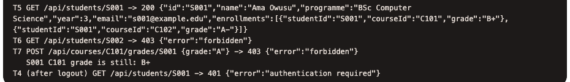
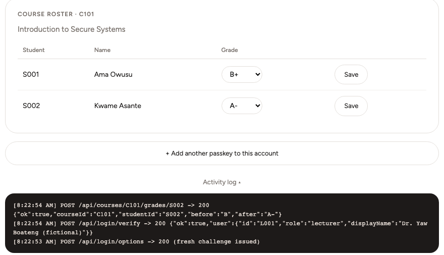
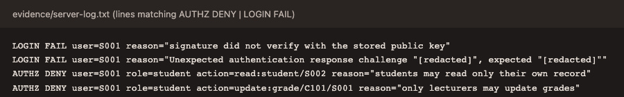
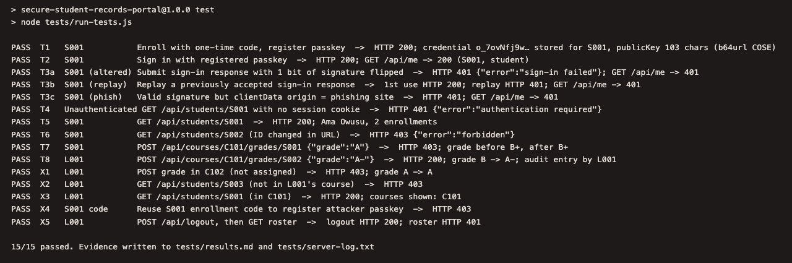
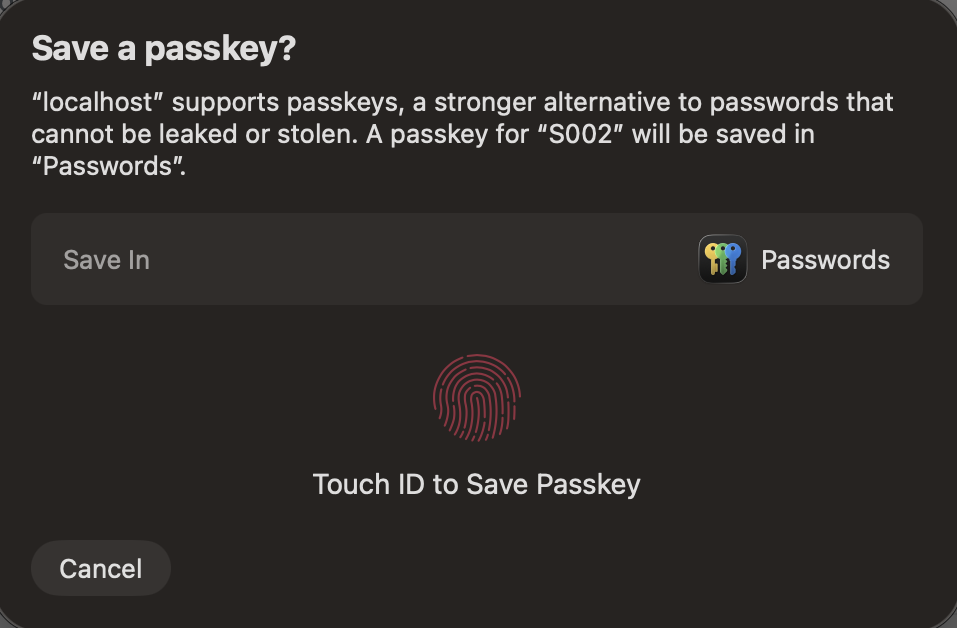
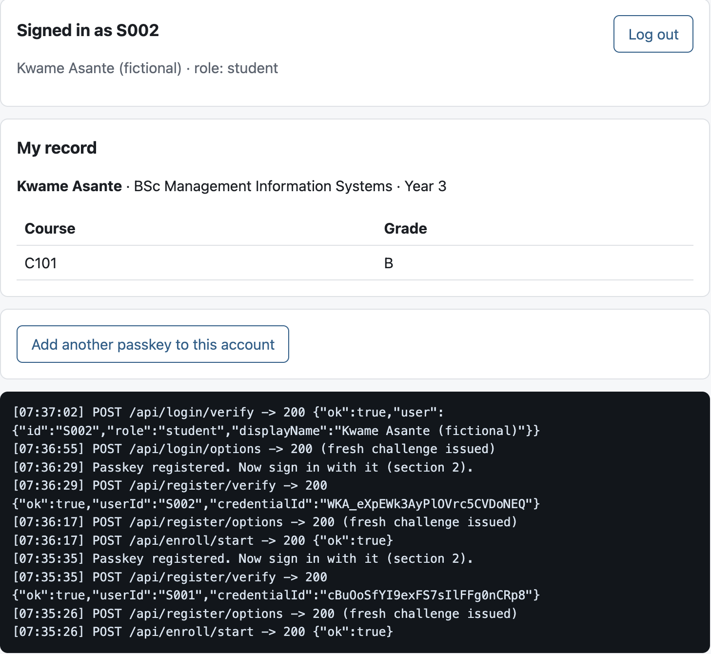

The portal runs on Node.js 22 with Express 5, express-session and SimpleWebAuthn 13 (server and browser), and keeps its data in a JSON file. All accounts and grades are synthetic, and the RP ID is `localhost`. The evidence run used `http://localhost:3001` because another service held port 3000 on the test machine; `PORT` sets the port, and the default is 3000.

# 1. T1 to T8 results

All tests were run on 19 October 2026 against a freshly seeded datastore. The browser screenshots were captured using Chromium's virtual WebAuthn authenticator driven by Playwright (`evidence/capture.mjs`). The script turns on a CTAP2 platform authenticator with resident keys and user verification through the Chrome DevTools Protocol, then works through the real portal UI: it enters the enrollment code, registers, signs in and clicks the security-test buttons. The authenticator creates real credentials and signatures, and the server verifies them with the same code it uses for any browser. Server output is in `evidence/server-log.txt`. `npm test` covers the same cases over HTTP with a software FIDO2 authenticator that makes real P-256 signatures, and it passed 15/15 (Figure 6, `tests/results.md`). Earlier that day I also registered S001 and S002 with Touch ID in my own browser and signed in as S002 (Figure 8). That run used the same server code, before the interface was restyled. The Observed column comes from the Playwright run.

| Test | Identity | Request / action | Expected | Observed (browser run) | Result |
|---|---|---|---|---|---|
| T1 | S001 | Enrollment code, then `POST /api/register/verify` | Credential bound to S001; public key stored | 200 `{"ok":true,"userId":"S001"}`; log `REGISTER OK user=S001` (Fig. 1) | Pass |
| T2 | S001 | `POST /api/login/verify` with passkey | Fresh challenge verified; session | 200, role student; S001 record shown (Fig. 2) | Pass |
| T3a | S001 | Sign-in response with 1 signature bit flipped | Rejected; no session | 401; `/api/me` 401; `LOGIN FAIL` signature did not verify (Fig. 3, 7) | Pass |
| T3b | S001 | Replay an accepted response after a new challenge | Rejected; no session | 1st use 200; replay 401 (challenge mismatch); `/api/me` 401 (Fig. 3, 7) | Pass |
| T4 | none | `GET /api/students/S001` after logout | 401 | 401 `authentication required` (Fig. 4) | Pass |
| T5 | S001 | `GET /api/students/S001` | Allowed | 200, own record (Fig. 4) | Pass |
| T6 | S001 | `GET /api/students/S002` (ID changed) | Denied | **403** `forbidden`; `AUTHZ DENY` (Fig. 4, 7) | Pass |
| T7 | S001 | `POST /api/courses/C101/grades/S001 {"grade":"A"}` (no UI offers this) | Denied; grade unchanged | **403**; grade still B+ (Fig. 4, 7) | Pass |
| T8 | L001 | Roster Save: `POST /api/courses/C101/grades/S002` | Allowed | 200; B to A-; log `GRADE UPDATE by=L001` (Fig. 5) | Pass |

`npm test` also ran five extra checks, all passing. A valid signature from a phishing origin (T3c) gets 401, and so does a request made after logout. L001 gets 403 when editing a grade in C102, a course L001 does not teach, and 403 when reading S003. Reusing an enrollment code also gets 403.

# 2. Selected evidence

Figures 1 to 7 are crops of the full-page screenshots in `evidence/`, and the log text in them is unedited.

{width=2.9in} {width=3.4in}

*Figure 1 (left), T1: S001 registration; `register/verify -> 200`. Figure 2 (right), T2: S001 signed in, own record displayed.*

{width=6.3in}

*Figure 3, T3: tampered signature and replayed response both rejected with 401; no session created.*

{width=6.3in}

*Figure 4, T5 to T7 and T4: direct requests as S001 (200, 403, 403, grade still B+), then 401 after logout.*

{width=4.2in}

*Figure 5, T8: L001 saves S002's C101 grade in the roster: 200, B to A-.*

{width=6.3in}

*Figure 7: `AUTHZ DENY` and `LOGIN FAIL` lines from `evidence/server-log.txt` for the rejected requests.*

{width=6.3in}

*Figure 6: `npm test` output, 15/15 passed.*

{width=2.5in} {width=2.7in}

*Figure 8: my own run with Touch ID on the earlier interface. Left, macOS asks to save the S002 passkey for localhost. Right, S002 is signed in and sees only S002's record; the log shows `register/verify -> 200` for S001 and S002 and `login/verify -> 200` for S002.*

**Policy check responsible (`src/policy.js`), called inside the route after `requireAuth`:**
```js
export function canUpdateGrade(user, courseId, studentId) {
  if (user.role !== 'lecturer') return deny('only lecturers may update grades');
  const course = findCourse(courseId);
  if (!course) return deny('no such course');
  if (!course.lecturerIds.includes(user.id)) return deny('lecturer is not assigned to this course');
  if (!findEnrollment(courseId, studentId)) return deny('student is not enrolled in this course');
  return allow();
}
```

# 3. Security interpretation

**A. Authentication vs authorization.** T2 proves only that the caller holds the private key for a passkey bound to S001. The server checked a fresh challenge, the origin, the RP ID and the signature against S001's stored public key, then stored `userId = S001` in the session. Permission is decided separately. In my code, `requireAuth` (server.js) only checks that a session exists and returns 401 when it does not (T4). Each protected route then calls `canReadStudent` or `canUpdateGrade` (policy.js), which check role, ownership and course assignment and deny by default. T6 and T7 were sent directly from the test page, outside the normal UI. Both returned 403 with `AUTHZ DENY` log entries, and the grade stayed B+.

**B. Residual weakness.** A passkey can only be as trustworthy as the enrollment step that bound it to the account. My one-time enrollment code is a bearer secret, so whoever uses it first registers their own passkey as that student. Reuse is blocked (403), but nothing detects a first use by the wrong person. There is also no recovery path, so a student who loses their device has to rely on whoever can reset accounts. A proportionate fix is to send codes out of band with a short expiry, notify the student whenever a passkey is added, and require an identity check approved by a second staff member before any re-enrollment.

**C. Transfer to SLS ProSit 2.** The closest match is the SLS Help Desk, where staff reset passwords and MFA enrollment using the same identity check for ordinary employees, Finance staff and privileged administrators. Phishing-resistant sign-in does not help if an attacker can talk the Help Desk into re-enrolling someone else's credential, because whoever controls recovery controls the account. Recovery should be authorized like any other privileged action: verify the caller through a channel the attacker does not control, require a second approver for Finance and administrator accounts, and alert the real owner. T6 and T7 apply the same rule in code. Reaching a function, whether a reset form or a help-desk phone line, should never be enough to use it on another person's account.

# 4. AI / tools declaration

AI was used to help plan the application design and write parts of the code. It also helped draft parts of the README and this report, and it wrote the Part B demo script and the Playwright capture script. I checked the passkey flow myself by registering S001 and S002 with Touch ID and signing in as S002; the server returned 200 at each step (Figure 8). Libraries used: SimpleWebAuthn for WebAuthn verification, express-session for sessions, Playwright for the evidence screenshots, and Node `crypto` for hashing, test signatures and Part B. I did not write any cryptographic primitives myself.
