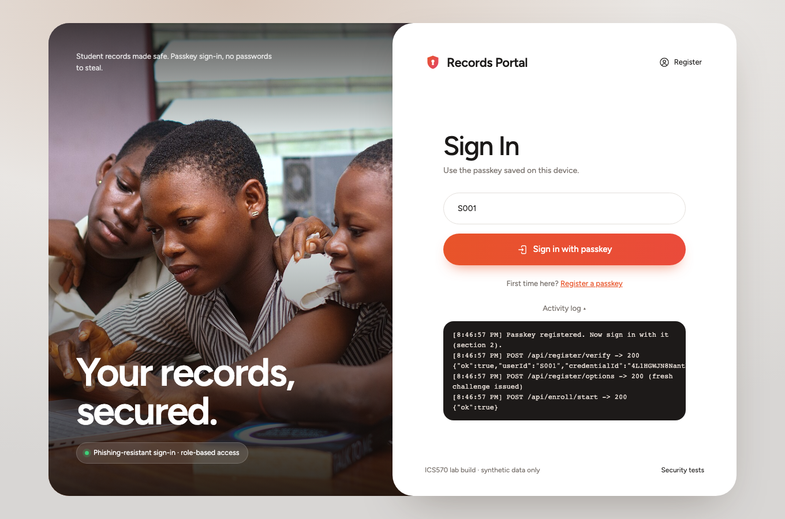
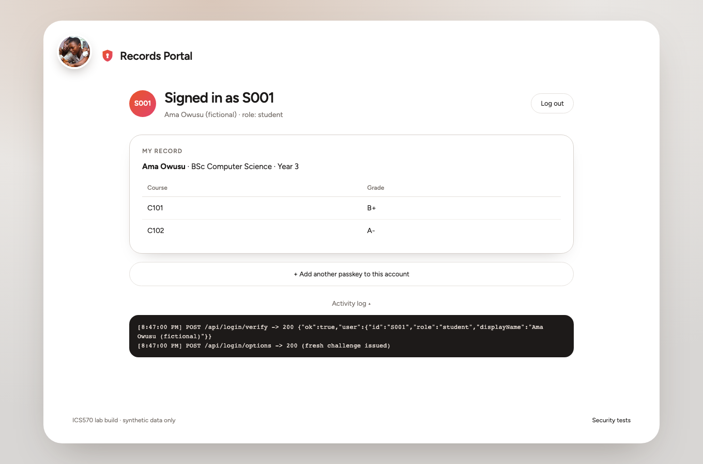
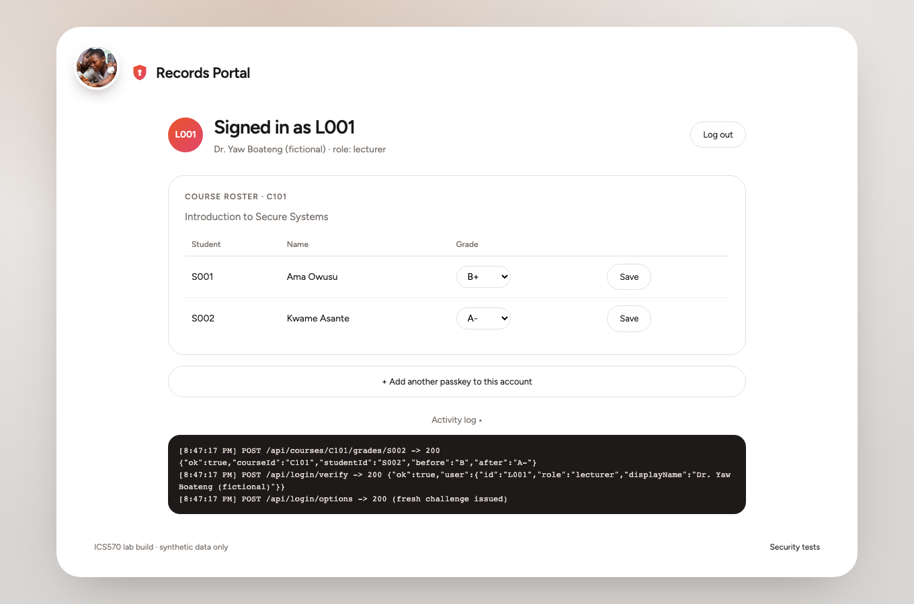
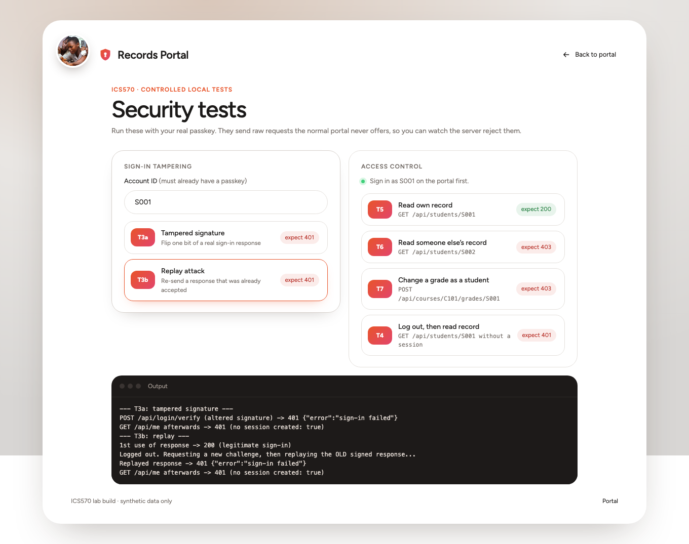
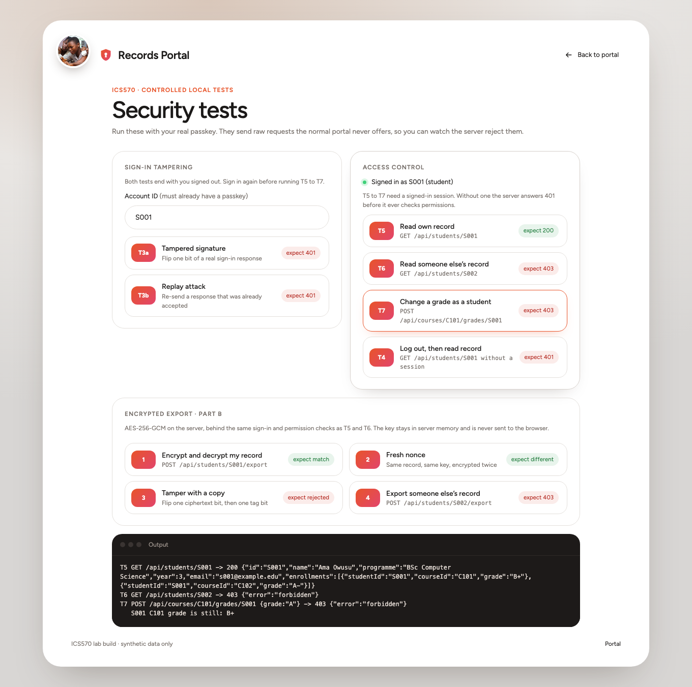
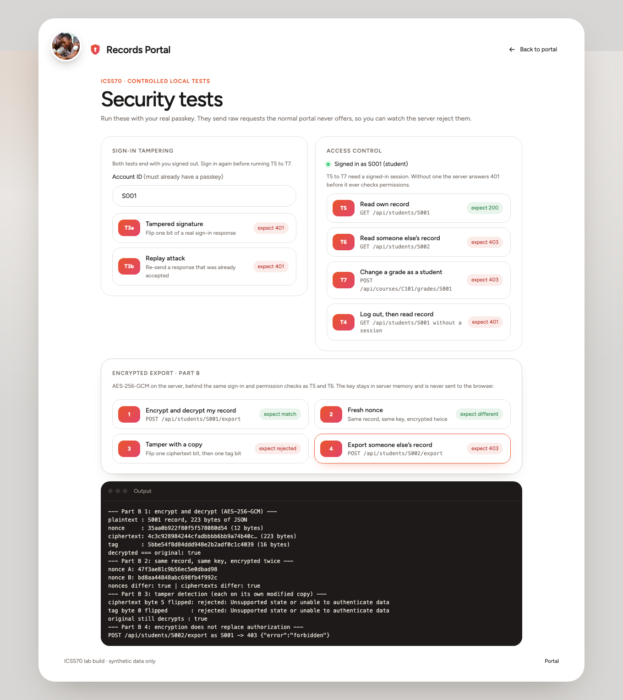
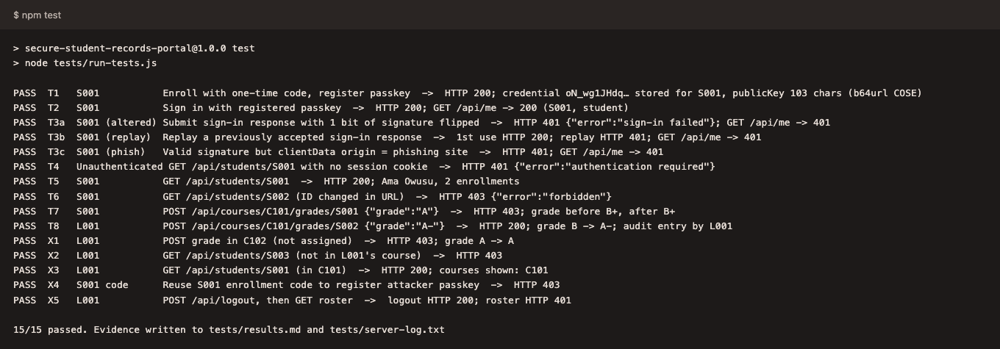

# Secure Student Records Portal (ICS570 Lab 2)

A deliberately simple portal showing passkey (WebAuthn/FIDO2) authentication and server-side, record-level authorization. **Synthetic data only.**

**Stack:** Node.js 20+ · Express 5 · express-session · @simplewebauthn/server 13 and @simplewebauthn/browser 13 · JSON-file datastore (`data/db.json`).

**Live demo:** https://ics570-records-portal.vercel.app. The hosted copy keeps its data in Upstash Redis; its Register page lists the unused one-time codes and has a *Reset demo* button that wipes all passkeys and issues new codes. Everything below describes the local run the lab asks for.

## Screenshots
**Sign-in page** (passkey only, no passwords)



**Student view:** S001 sees only their own record



**Lecturer view:** L001 edits grades for their assigned course (C101)



**Security test page:** tampered signature (T3a) and replayed sign-in (T3b) are both rejected with 401



**Security test page:** as S001, reading S002's record (T6) or changing a grade (T7) returns 403



**Part B, encrypted export:** AES-256-GCM encrypt and decrypt, fresh nonce, tamper detection, and 403 when exporting S002's record



**Automated test run:** `npm test` passes 15/15



## Prerequisites
- Node.js 20 or newer (`node -v`)
- Chrome, Edge or Safari, plus an authenticator: Windows Hello, Touch ID, a phone passkey (QR code), a security key, or the browser's passkey manager
- Open the portal at **http://localhost:3000**. WebAuthn treats localhost as a secure context. Do not use `127.0.0.1` or a LAN IP, because the RP ID is `localhost`.

## Install and run
```bash
npm install
npm start         # http://localhost:3000; the first run seeds data/db.json
npm test          # automated T1 to T8 matrix on port 3100 with its own test datastore
```
**Enrollment codes:** each `npm start` prints the one-time code for every account that has not registered a passkey yet. They are also saved in `data/db-enrollment-codes.txt` (gitignored). Passkeys and grades persist in `data/db.json` across restarts; `npm run seed -- --reset` wipes everything and prints new codes.

## Test accounts (fictional)
**S001** student (C101, C102) · **S002** student (C101) · **S003** student (C102) · **L001** lecturer, assigned to **C101** · **L002** lecturer (C102). The Register page lists them too.

## How it works
- **Registration:** account ID plus one-time code (stored as a SHA-256 hash, single-use) unlocks a registration challenge; the library verifies challenge, origin, RP ID and user verification, and the credential ID and public key are stored against that account.
- **Sign-in:** a fresh challenge is held in the session and consumed before the signature is verified against the stored public key; the session ID is then regenerated.
- **Authorization:** `requireAuth` returns 401 with no session; each protected route then calls `src/policy.js`, which returns 403 and logs `AUTHZ DENY` on denial. Cookies are `httpOnly`, `sameSite=strict`, 30-minute expiry; logs never contain cookies, codes, challenges or keys.

## Repeating T1 to T8 and Part B
**Automated (all tests):** run `npm test`. It uses a software authenticator (real P-256 signatures via Node `crypto`) through the same server verification code. It writes `tests/results.md` and `tests/server-log.txt`.

**Browser screenshots (optional):** after `npm run seed -- --reset`, with the server running: `npm install --no-save playwright && npx playwright install chromium`, then `node evidence/capture.mjs` (Chromium virtual WebAuthn authenticator; it reads the codes file).

**Manually in a browser (real passkey):**

- **T1:** `npm start` and note S001's code in the terminal. On the portal, click *Register* (top right), enter `S001` and its code, then click *Register passkey* and approve the prompt.
- **T2:** under *Sign in*, enter `S001`, click *Sign in* and approve. You should see S001's record.
- **T3:** open `/security-tests.html`. Click **T3a** and **T3b**. Both should return 401 with `LOGIN FAIL` in the server terminal, and both leave you signed out.
- **T5, T6, T7:** click *Sign in with passkey* on the test page (as S001), then use the buttons. Alternatively, run these in the DevTools console:
   ```js
   fetch('/api/students/S002').then(r => r.status)                                  // T6 -> 403
   fetch('/api/courses/C101/grades/S001', {method:'POST', headers:{'Content-Type':'application/json'}, body:'{"grade":"A"}'}).then(r => r.status)  // T7 -> 403
   ```
- **T4:** log out, then open http://localhost:3000/api/students/S001. It should return 401.
- **T8:** register and sign in as `L001`. In the C101 roster, change S002's grade and click *Save*. It should return 200.
- **Part B:** signed in as S001 on the test page, click **1** to **4** under *Encrypted export* (AES-256-GCM on the server; exporting S002's record returns 403). The standalone script is `node partB/crypto-demo.js`.
