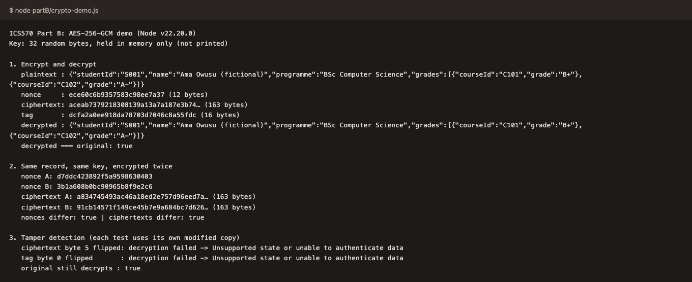
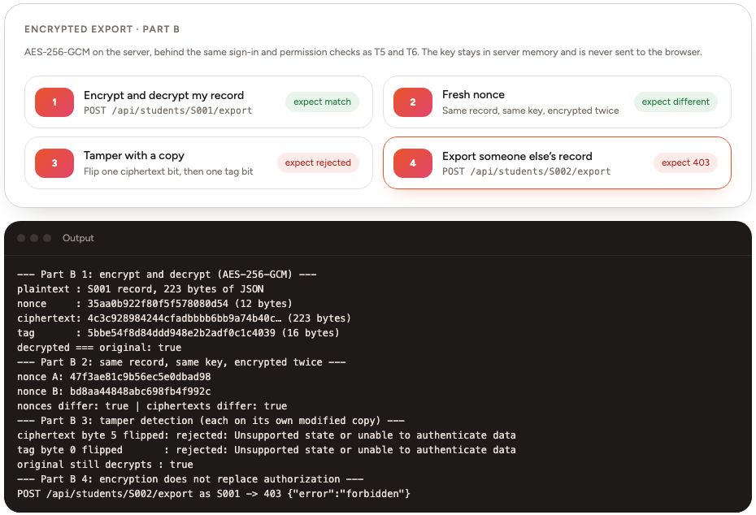

The script is `partB/crypto-demo.js`, run with `node partB/crypto-demo.js`. It uses `aes-256-gcm` from Node's built-in `crypto` module, so no AES code was written by hand, and it encrypts one fictional student record (S001) stored as JSON. The full output is in `partB/output.txt`.

# Evidence

{width=5.2in}

*Figure 1: unedited output of `node partB/crypto-demo.js`. The key is never printed.*

| Task | What the script does | Observed result |
|---|---|---|
| 1. Encrypt and decrypt | Encrypts the JSON record with a random 32-byte key and a 12-byte nonce, then decrypts it with the same key, nonce and tag | `decrypted === original: true` |
| 2. Fresh nonce | Encrypts the same record twice with the same key | Different nonces and different ciphertexts (`nonces differ: true`, `ciphertexts differ: true`) |
| 3. Integrity | Flips one bit of ciphertext byte 5 in one copy and one bit of tag byte 0 in a separate copy, then tries to decrypt each | Both throw `Unsupported state or unable to authenticate data`; no altered plaintext is returned. The untouched original still decrypts |

The same steps also run inside the portal, in the *Encrypted export* section of the Security tests page. There the server encrypts the signed-in student's own record through `POST /api/students/:studentId/export`, which sits behind the same `requireAuth` and `canReadStudent` checks as T5 and T6. Signed in as S001, exporting S002's record returns 403 before any encryption happens (Figure 2).

{width=5.2in}

*Figure 2: the portal's encrypted-export demo, signed in as S001. The key stays in server memory and never reaches the browser.*

# Key protection

The script generates the 256-bit key with `crypto.randomBytes(32)` when it starts, keeps it in memory, and never prints or saves it. Anyone holding the key can read every record it protects and forge records that pass the integrity check. In a real portal it would sit in a key-management service or hardware security module. Only the export service would be allowed to use it, each use would be logged, and the key would be rotated on a schedule. It would not appear in source code, configuration files or logs.

# Why nonce reuse is dangerous

GCM uses the nonce to generate a keystream that is XOR-ed with the plaintext. If two messages are encrypted with the same key and nonce, they share that keystream, and XOR-ing the two ciphertexts cancels it out and leaves the XOR of the two plaintexts. With structured data such as student JSON, that can be enough to recover grades. Reuse also leaks the authentication subkey, which lets an attacker forge tags that verify. The script draws a fresh random 96-bit nonce for every encryption and stores it next to the ciphertext and tag; the nonce does not need to be secret.

# Boundary with passkeys and authorization

AES-GCM keeps the exported record confidential and detects tampering, but it cannot tell the server who is asking for the record. A passkey answers that by proving, with a fresh origin-bound signature, which account holder is present. Server-side authorization then decides whether that user may read S002's record or change a grade, which is what T6 and T7 tested in Part A. If a service decrypted records for any signed-in user without that check, a student could still read another student's data.
